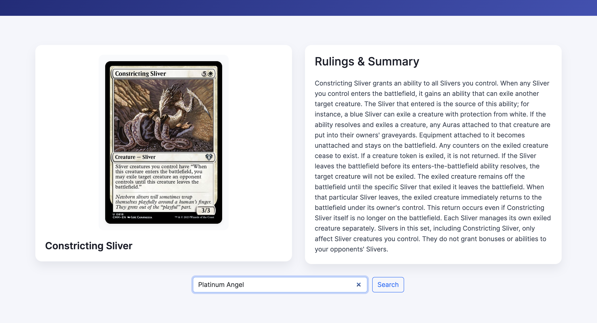
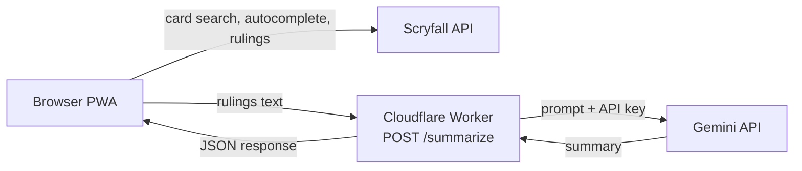

# XTCAI: Magic: The Gathering Card Explainer

A progressive web app that looks up any _Magic: The Gathering_ card and turns its official rulings into a short, plain-English summary using Gemini.

**Live demo:** https://crazypergy.github.io/xctai/



## Why I built it

Magic card rulings are accurate but dense. Many cards have a dozen rulings written in rules-lawyer language. XTCAI pulls those rulings from Scryfall and condenses them into a few direct sentences, so a newer player can understand how a card actually behaves.

## Features

- **Card search with autocomplete** backed by Scryfall's autocomplete endpoint
- **Random card** button for browsing
- **Card art and name** displayed alongside the summary
- **AI summaries** of official rulings, written in a concise, non-conversational tone
- **Installable PWA** with a service worker that caches the app shell
- **Responsive layout** for phone and desktop
- **Graceful failure states** for missing rulings, failed lookups, and failed summaries

## How it works



1. The browser queries the **Scryfall API** directly for card data, artwork, and rulings.
2. The rulings text is sent to a **Cloudflare Worker** at `/summarize`.
3. The Worker adds the API key and forwards the prompt to **Gemini** (`gemini-2.5-flash`).
4. The summary comes back through the Worker and is shown in the page.

The Gemini API key lives only in the Worker as a Cloudflare secret. It is never shipped to the browser or stored in this repo.

## Tech stack

| Layer     | Technology                                       |
| --------- | ------------------------------------------------ |
| Frontend  | HTML, CSS, vanilla JavaScript, Bootstrap 5 (CDN) |
| PWA       | Web app manifest, service worker                 |
| Backend   | Cloudflare Workers                               |
| AI        | Google Gemini API                                |
| Card data | [Scryfall API](https://scryfall.com/docs/api)    |
| Hosting   | GitHub Pages (frontend), Cloudflare (Worker)     |

## Project structure

```
.
├── index.html            # App markup and service worker registration
├── script.js             # Search, autocomplete, Scryfall calls, summary request
├── style.css             # Layout and styling
├── manifest.json         # PWA manifest
├── service-worker.js     # App shell caching
├── cloudflare/
│   └── worker.js         # Worker that proxies requests to Gemini
├── wrangler.toml         # Worker configuration
└── .env.example          # Placeholder for the required secret
```

## Running it locally

**Frontend.** It's a static site, so any local server works:

```bash
npx serve .
```

**Worker.** To run your own backend:

```bash
npm install -g wrangler        # or use npx wrangler
cp .env.example .dev.vars      # then put your Gemini API key in .dev.vars
npx wrangler dev
```

Then point `SUMMARY_API_URL` at the top of `script.js` to your local Worker (for example `http://localhost:8787/summarize`).

Get a Gemini API key from [Google AI Studio](https://aistudio.google.com/apikey).

## Deploying your own copy

1. Deploy the Worker:
   ```bash
   npx wrangler deploy
   ```
2. Store your key as a secret (never in the repo):
   ```bash
   npx wrangler secret put GEMINI_API_KEY
   ```
3. Update `SUMMARY_API_URL` in `script.js` to your Worker's URL.
4. Host the static files anywhere, such as GitHub Pages.

## Security notes

- API keys are stored as Cloudflare secrets and read from `env.GEMINI_API_KEY`.
- `.env` and `.dev.vars` are git-ignored. `.env.example` contains placeholders only.
- GitHub secret scanning and push protection are enabled on this repo.

## Roadmap

- App icons for full PWA installability
- Offline fallback page
- Rate limiting on the Worker
- Restrict CORS to the production origin

## Acknowledgments

Card data and images are provided by [Scryfall](https://scryfall.com). XTCAI is unofficial fan content and is not affiliated with or endorsed by Wizards of the Coast. _Magic: The Gathering_ is a trademark of Wizards of the Coast LLC.

## License

[MIT](LICENSE)
